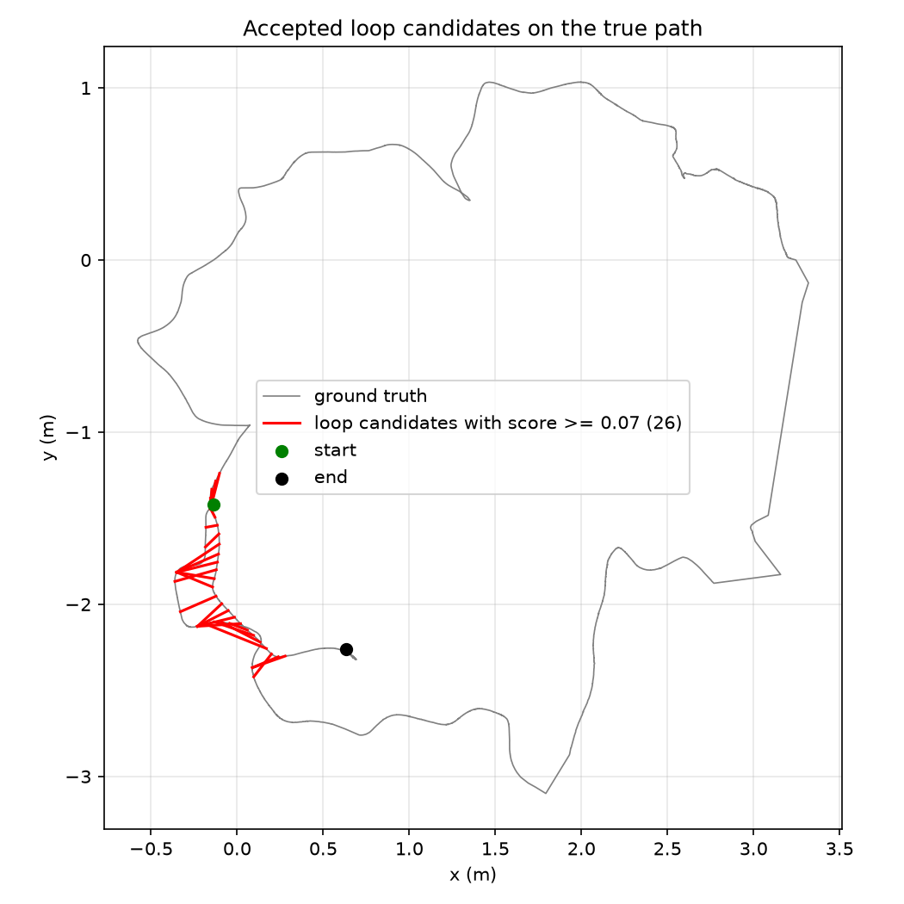
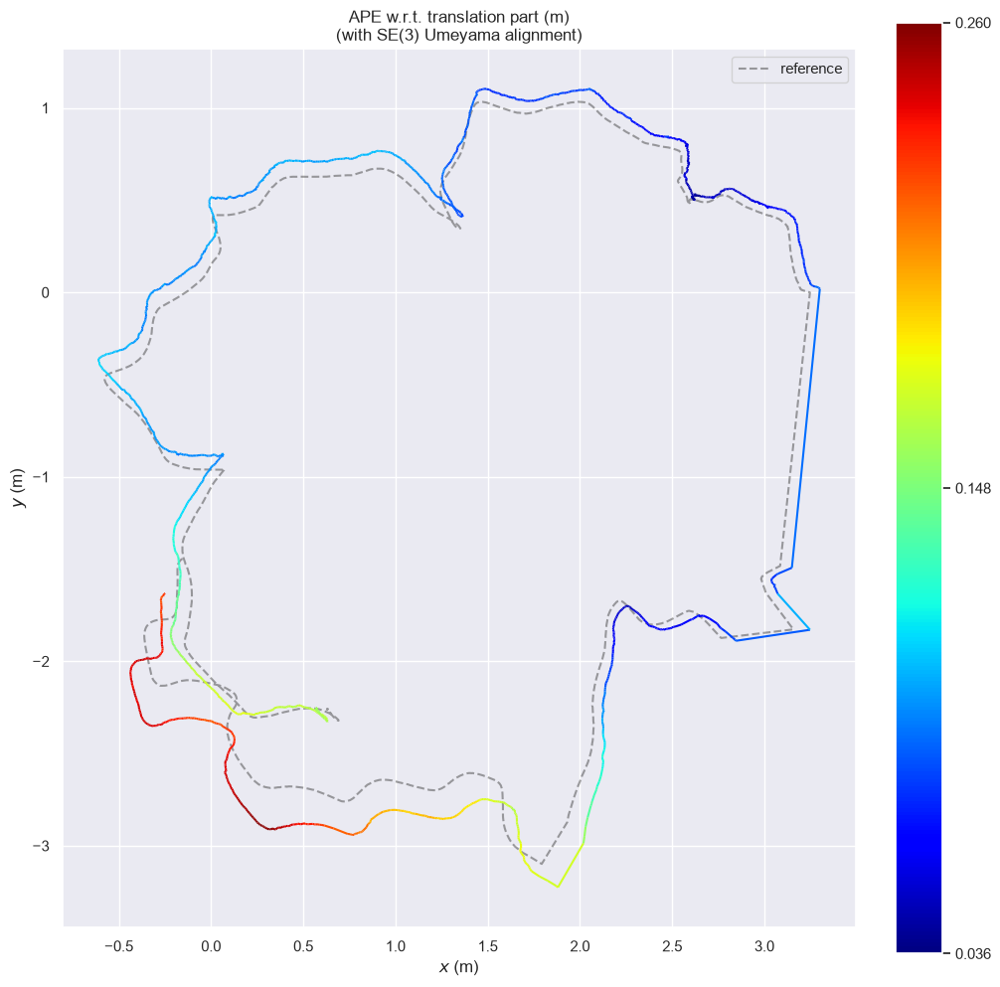

# Real-Time Visual SLAM

[](https://github.com/Adiaharoni55/realtime-visual-slam/actions/workflows/ci.yml)

A real-time C++17 SLAM system that estimates motion and builds a 3D map from a camera and a LiDAR. A deep-learning segmentation model (ONNX Runtime) masks moving objects such as people and cars, so they don't corrupt tracking.

> **Status: v0.2, backend.** RGB-D visual odometry with local bundle adjustment, bag-of-words loop closure and pose-graph optimization, evaluated on four TUM sequences. Next: masking moving objects with a deep-learning model.

## Progress

| Step | Status |
| --- | --- |
| 1. Project setup: CMake, sanitizers, unit tests, CI on Linux / macOS / Windows | ✅ Done |
| 2. Camera geometry: pinhole model, poses and quaternions, YAML camera config | ✅ Done |
| 3. Visual odometry on TUM RGB-D | ✅ Done (v0.1) |
| 4. Backend: bundle adjustment, pose graph, loop closure | ✅ Done (v0.2) |
| 5. Masking moving objects with a deep-learning model (ONNX Runtime) | Planned |
| 6. LiDAR + camera fusion on KITTI | Planned |
| 7. Real-time performance: multithreading, profiling | Planned |
| 8. Docker, ROS 2 node, visualization | Planned |
| 9. Final results and evaluation | Planned |

## What works today

- **Pinhole camera model:** project 3D points to pixels and back-project pixels with depth to 3D, with input validation.
- **Pose utilities:** TUM-format poses (translation + quaternion) to 4×4 rigid transforms, and relative motion between poses.
- **Camera config:** intrinsics loaded from YAML files in `configs/`.
- **TUM RGB-D loader:** reads image lists and ground truth, and associates RGB and depth by timestamp (binary search, validated input). Ground truth is optional, so it never decides which frames get tracked.
- **ORB features:** detection and matching with Lowe's ratio test.
- **Motion estimation:** PnP + RANSAC on depth-backprojected points, with keypoint undistortion.
- **Visual odometry:** frame-to-keyframe tracking (new keyframe after 5 cm, 5° or too few inliers), writing a TUM-format trajectory and per-frame statistics.
- **Evaluation:** ATE/RPE with evo on three sequences, a threshold sweep, and a [failure analysis](docs/failure-analysis.md).
- **Unit tests** for all of the above (GoogleTest, including synthetic scenes with known motion), run in CI on every push.
- **Sanity check:** rejects motion estimates with too few inliers or an impossible jump between frames.
- **Local map + bundle adjustment:** 3D points with their observations; local BA over the last 10 keyframes (Ceres, Huber loss, reprojection and depth residuals).
- **Loop closure:** an ORB vocabulary trained with DBoW2 (own tool, binary format), bag-of-words place recognition, PnP verification, and pose-graph optimization on SE(3).

## Results

ATE (RMSE, cm) on TUM RGB-D, evaluated with [evo](https://github.com/MichaelGrupp/evo) (`--align`). Release build, Apple Silicon.

| Sequence | Odometry | + local BA | + loop closure | + BA + loop closure |
| --- | --- | --- | --- | --- |
| fr1/xyz* | 5.0 | 3.9 | **1.3** | 1.4 |
| fr1/desk* | 6.5 | 5.3 | 4.1 | **3.6** |
| fr2/desk | 13.3 | 9.5 | **4.6** | 6.1 |
| fr1/room* | 30.3 | 28.9 | 9.8 | **9.3** |

\* in the ORB vocabulary's training set; fr2/desk is held out.

Speed: ~15 ms/frame for odometry, ~24–33 ms/frame with local BA (each BA run takes 44–79 ms and runs on keyframes only).

**Loop closure** cuts the error by 2.9× on fr2/desk and 3.3× on fr1/room. Bag-of-words finds the revisited places, and PnP verification rejects false candidates: on fr1/room, all 12 candidates between places 1.2–2.1 m apart were rejected.




**BA and loop closure don't simply add up.** Combined, they're best on fr1/desk and fr1/room, but worse than loop closure alone on fr2/desk. All edges in the pose graph are weighted equally, although BA-refined and PnP-measured edges differ in accuracy; weighting edges by their uncertainty is future work. Details in the [failure analysis](docs/failure-analysis.md).

### Reproduce

```bash
cmake --preset release && cmake --build --preset release
./build/release/rtvm_train_vocab models/orb_vocab.bin data/rgbd_dataset_freiburg1_xyz data/rgbd_dataset_freiburg1_desk data/rgbd_dataset_freiburg1_room
./build/release/rtvm_run_vo data/rgbd_dataset_freiburg2_desk configs/tum_fr2.yaml --ba --vocab models/orb_vocab.bin
evo_ape tum data/rgbd_dataset_freiburg2_desk/groundtruth.txt output/trajectory.txt --align
```

## Planned pipeline

1. Read camera frames (TUM RGB-D, KITTI) and LiDAR scans (KITTI).
2. Segment moving objects with an ONNX model and build a mask.
3. Detect and match ORB features outside the mask; estimate motion with PnP + RANSAC.
4. Project LiDAR points into the image, drop those on moving objects, and align scans with ICP.
5. Optimize with a pose graph, bundle adjustment and loop closure.
6. Visualize with Rerun and score against ground truth (ATE / RPE).

## Tech stack

C++17 · CMake + presets · vcpkg · Eigen · OpenCV · yaml-cpp · GoogleTest · GitHub Actions · ASan / UBSan · evo (Python)
*Planned:* Ceres, ONNX Runtime, Open3D, Rerun, Docker, ROS 2

## Build

**Requirements:** a C++17 compiler (Clang, GCC or MSVC), CMake ≥ 3.25, Ninja, and [vcpkg](https://github.com/microsoft/vcpkg) with the `VCPKG_ROOT` environment variable set. On macOS, also `brew install pkg-config`.

```bash
git clone https://github.com/Adiaharoni55/realtime-visual-slam.git
cd realtime-visual-slam

cmake --preset debug             # configure; vcpkg installs dependencies on first run
cmake --build --preset debug     # build
ctest --test-dir build/debug --output-on-failure   # run unit tests
./build/debug/rtvm               # run the app
```

Use the `release` preset for optimized builds. Debug builds run with AddressSanitizer and UndefinedBehaviorSanitizer.

## Data

Download the TUM RGB-D sequence [`freiburg1_xyz`](https://cvg.cit.tum.de/data/datasets/rgbd-dataset/download) (tgz) and unpack it into `data/`:

```bash
mkdir -p data && cd data
tar -xzf rgbd_dataset_freiburg1_xyz.tgz
```

The results above also use `freiburg2_desk` and `freiburg1_desk`, from the same page and unpacked the same way. Use `configs/tum_fr1.yaml` for fr1 sequences and `configs/tum_fr2.yaml` for fr2 sequences.

The `data/` folder is not tracked by Git.

## Project structure

```
realtime-visual-slam/
├── include/rtvm/   # Public headers
├── src/            # Library implementation
├── apps/           # Programs: rtvm, rtvm_match_demo, rtvm_run_vo
├── tests/          # Unit tests and small test fixtures
├── configs/        # Camera parameters (YAML)
├── scripts/        # Python helpers (plotting, evaluation)
├── docs/           # Failure analysis and images
├── CMakeLists.txt
├── CMakePresets.json
└── vcpkg.json      # Dependencies
```

## References

- J. Sturm et al., *A Benchmark for the Evaluation of RGB-D SLAM Systems*, IROS 2012 (TUM RGB-D dataset).

## License

MIT