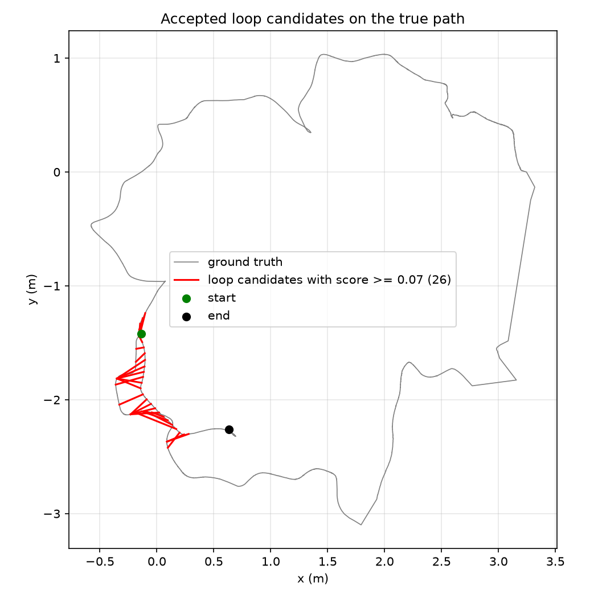
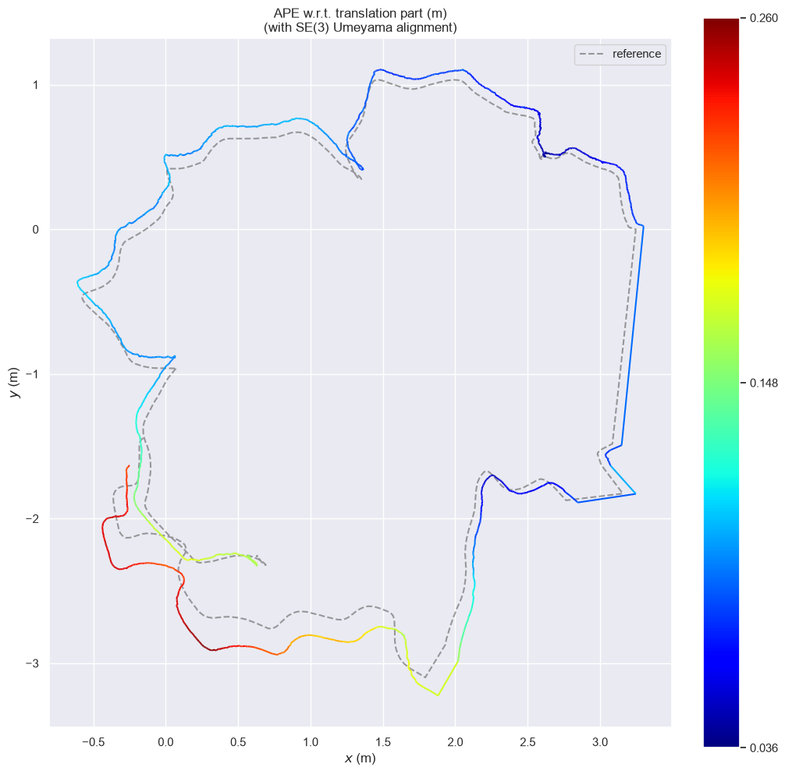

# Real-Time Visual SLAM

[](https://github.com/Adiaharoni55/realtime-visual-slam/actions/workflows/ci.yml)

A real-time C++17 SLAM system that estimates motion and builds a 3D map from a camera and a LiDAR. A deep-learning segmentation model (ONNX Runtime) masks moving objects such as people and cars, so they don't corrupt tracking.

> **Status: v0.3, dynamic scenes.** A person-segmentation network (DeepLabV3-MobileNetV3, ONNX Runtime) masks keypoints on people. Results are reported as mean ± std over 5 runs. Next: LiDAR + camera fusion on KITTI.

## Progress

| Step | Status |
| --- | --- |
| 1. Project setup: CMake, sanitizers, unit tests, CI on Linux / macOS / Windows | ✅ Done |
| 2. Camera geometry: pinhole model, poses and quaternions, YAML camera config | ✅ Done |
| 3. Visual odometry on TUM RGB-D | ✅ Done (v0.1) |
| 4. Backend: bundle adjustment, pose graph, loop closure | ✅ Done (v0.2) |
| 5. Masking moving objects with a deep-learning model (ONNX Runtime) | ✅ Done (v0.3) |
| 6. LiDAR + camera fusion on KITTI | Planned |
| 7. Real-time performance: multithreading, profiling | Planned |
| 8. Docker, ROS 2 node, visualization | Planned |
| 9. Final results and evaluation | Planned |

## What works today

- **Pinhole camera model:** project 3D points to pixels and back-project pixels with depth to 3D, with input validation.
- **Pose utilities:** TUM-format poses (translation + quaternion) to 4×4 rigid transforms, and relative motion between poses.
- **Camera config:** intrinsics loaded from YAML files in `configs/`.
- **TUM RGB-D loader:** reads image lists and ground truth, and associates RGB and depth by timestamp (binary search, validated input). Ground truth is optional, so it never decides which frames get tracked.
- **ORB features:** detection and matching with Lowe's ratio test.
- **Motion estimation:** PnP + RANSAC on depth-backprojected points, with keypoint undistortion.
- **Visual odometry:** frame-to-keyframe tracking (new keyframe after 5 cm, 5° or too few inliers), writing a TUM-format trajectory and per-frame statistics.
- **Evaluation:** ATE/RPE with evo on three sequences, a threshold sweep, and a [failure analysis](docs/failure-analysis.md).
- **Unit tests** for all of the above (GoogleTest, including synthetic scenes with known motion), run in CI on every push.
- **Sanity check:** rejects motion estimates with too few inliers or an impossible jump between frames.
- **Local map + bundle adjustment:** 3D points with their observations; local BA over the last 10 keyframes (Ceres, Huber loss, reprojection and depth residuals).
- **Loop closure:** an ORB vocabulary trained with DBoW2 (own tool, binary format), bag-of-words place recognition, PnP verification, and pose-graph optimization on SE(3).
- **Loop consistency check:** a verified loop is accepted only if it agrees with odometry within 0.2 m + 10% of the path in between (and a matching rotation limit: 10° + 3° per meter).
- **Person masking:** DeepLabV3-MobileNetV3 exported to ONNX (verified against PyTorch: max difference 1.6e-5), run from C++ with ONNX Runtime (~35 ms per image on CPU; Core ML was slower on this setup). Keypoints are not detected inside the dilated person mask.

## Results

ATE (RMSE, cm) on TUM RGB-D, evaluated with [evo](https://github.com/MichaelGrupp/evo) (`--align`). Release build, Apple Silicon.

| Sequence | Odometry | + local BA | + loop closure | + BA + loop closure |
| --- | --- | --- | --- | --- |
| fr1/xyz* | 5.0 | 3.9 | **1.3** | 1.4 |
| fr1/desk* | 6.5 | 5.3 | 4.1 | **3.6** |
| fr2/desk | 13.3 | 9.5 | **4.6** | 6.1 |
| fr1/room* | 30.3 | 28.9 | 9.8 | **9.3** |

\* in the ORB vocabulary's training set; fr2/desk is held out.

Speed: ~15 ms/frame for odometry, ~24–33 ms/frame with local BA (each BA run takes 44–79 ms and runs on keyframes only).

**Loop closure** cuts the error by 2.9× on fr2/desk and 3.1× on fr1/room. Bag-of-words finds the revisited places, and PnP verification rejected all 12 false candidates on fr1/room (0–7 inliers). It isn't sufficient everywhere: on fr3/structure_texture_far, one false loop (2.3 m and 46° wrong) passed with 51 inliers and pushed ATE to 41.7 cm. A consistency check against odometry now rejects it; it rejects no loop on the four sequences above.




**BA and loop closure don't simply add up.** Combined, they're best on fr1/desk and fr1/room, but worse than loop closure alone on fr2/desk. All edges in the pose graph are weighted equally, although BA-refined and PnP-measured edges differ in accuracy; weighting edges by their uncertainty is future work. Details in the [failure analysis](docs/failure-analysis.md).

### Dynamic scenes (Step 5)

TUM fr3 sequences with people (walking_xyz, sitting_xyz) and a static control scene (structure_texture_far). 5 runs per configuration, starting at frames 0–4; ATE and RPE (30 frames) in cm as mean ± std. "Loops" is the mean number of accepted loops; none of them was wrong against the ground truth (0.3 m / 10°).

| Sequence | Configuration | ATE | RPE | Loops | Failed frames |
| --- | --- | --- | --- | --- | --- |
| walking_xyz | odometry | 18.37 ± 0.02 | 12.16 ± 0.01 | – | 107 |
| | odometry + mask | 20.55 ± 0.19 | 11.30 ± 0.01 | – | 107 |
| | loop closure | 12.15 ± 0.03 | 11.27 ± 0.01 | 12 | 107 |
| | loop closure + mask | 13.47 ± 2.96 | 10.56 ± 0.26 | 23 | 107 |
| sitting_xyz | odometry | 19.29 ± 0.03 | 5.07 ± 0.00 | – | 55 |
| | odometry + mask | 13.06 ± 0.01 | 5.47 ± 0.00 | – | 53 |
| | loop closure | 4.21 ± 0.01 | 3.78 ± 0.01 | 39 | 55 |
| | loop closure + mask | 4.87 ± 0.02 | 4.54 ± 0.01 | 84 | 53 |
| structure_texture_far (static) | odometry | 8.54 ± 0.51 | 2.79 ± 0.06 | – | 0 |
| | odometry + mask | 5.41 ± 0.23 | 2.47 ± 0.06 | – | 0 |
| | local BA | 4.55 ± 0.39 | 2.07 ± 0.04 | – | 0 |
| | loop closure | 5.81 ± 0.18 | 4.42 ± 0.04 | 6 | 0 |
| | BA + loop closure | 5.29 ± 0.06 | 4.14 ± 0.02 | 6 | 0 |

Masking reliably doubles the number of correct loops and slightly lowers RPE on walking_xyz, but it doesn't reliably improve ATE. Most tracking failures happen while the camera faces the ceiling, which masking can't help. On the static control scene, the model falsely marks a blurred patch at a depth edge on 71 frames, and masking it improves tracking (8.5 → 5.4 cm): part of the gain may come from removing bad regions rather than people.

Speed with masking: ~35 ms per image for the segmentation, about 65 ms per frame in total (~15 FPS).

The spreads are mostly small, but one configuration is bimodal (walking with loop closure and mask: 10.1 or 15.5 cm), so single runs can mislead. Details, the noise level and the edge-weighting problem are in the [failure analysis](docs/failure-analysis.md).

### Reproduce

```bash
cmake --preset release && cmake --build --preset release
./build/release/rtvm_train_vocab models/orb_vocab.bin data/rgbd_dataset_freiburg1_xyz data/rgbd_dataset_freiburg1_desk data/rgbd_dataset_freiburg1_room
./build/release/rtvm_run_vo data/rgbd_dataset_freiburg2_desk configs/tum_fr2.yaml --ba --vocab models/orb_vocab.bin
evo_ape tum data/rgbd_dataset_freiburg2_desk/groundtruth.txt output/trajectory.txt --align

# Step 5: export the segmentation model, run with masking, and the 5-run table
pip install torch torchvision onnx onnxruntime pillow
python scripts/export_segmentation.py      # writes models/deeplabv3_mobilenet.onnx
./build/release/rtvm_run_vo data/rgbd_dataset_freiburg3_walking_xyz configs/tum_fr3.yaml --vocab models/orb_vocab.bin --mask models/deeplabv3_mobilenet.onnx
python scripts/noise_runs.py               # all configurations above, ~30 min; writes output/noise_runs.csv
python scripts/check_loops.py data/rgbd_dataset_freiburg3_walking_xyz   # last run's loops vs. ground truth
```

`--start <frame>` skips the first frames (used for the repeated runs).

## Planned pipeline

1. Read camera frames (TUM RGB-D, KITTI) and LiDAR scans (KITTI).
2. Segment moving objects with an ONNX model and build a mask.
3. Detect and match ORB features outside the mask; estimate motion with PnP + RANSAC.
4. Project LiDAR points into the image, drop those on moving objects, and align scans with ICP.
5. Optimize with a pose graph, bundle adjustment and loop closure.
6. Visualize with Rerun and score against ground truth (ATE / RPE).

## Tech stack

C++17 · CMake + presets · vcpkg · Eigen · OpenCV · Ceres · DBoW2 · yaml-cpp · ONNX Runtime · GoogleTest · GitHub Actions · ASan / UBSan · evo (Python) · PyTorch (model export only)
*Planned:* Open3D, Rerun, Docker, ROS 2

## Build

**Requirements:** a C++17 compiler (Clang, GCC or MSVC), CMake ≥ 3.25, Ninja, and [vcpkg](https://github.com/microsoft/vcpkg) with the `VCPKG_ROOT` environment variable set. On macOS, also `brew install pkg-config`.

```bash
git clone https://github.com/Adiaharoni55/realtime-visual-slam.git
cd realtime-visual-slam

cmake --preset debug             # configure; vcpkg installs dependencies on first run
cmake --build --preset debug     # build
ctest --test-dir build/debug --output-on-failure   # run unit tests
./build/debug/rtvm               # run the app
```

Use the `release` preset for optimized builds. Debug builds run with AddressSanitizer and UndefinedBehaviorSanitizer.

## Data

Download the TUM RGB-D sequence [`freiburg1_xyz`](https://cvg.cit.tum.de/data/datasets/rgbd-dataset/download) (tgz) and unpack it into `data/`:

```bash
mkdir -p data && cd data
tar -xzf rgbd_dataset_freiburg1_xyz.tgz
```

The results above also use `freiburg2_desk`, `freiburg1_desk` and `freiburg1_room`, from the same page and unpacked the same way (`freiburg1_room` is also needed to train the ORB vocabulary). The Step 5 results use the fr3 sequences `freiburg3_walking_xyz`, `freiburg3_sitting_xyz` and `freiburg3_structure_texture_far`. Use `configs/tum_fr1.yaml` for fr1 sequences, `configs/tum_fr2.yaml` for fr2 and `configs/tum_fr3.yaml` for fr3.

The segmentation model (`models/deeplabv3_mobilenet.onnx`) is created by `scripts/export_segmentation.py`; ONNX Runtime itself is downloaded by CMake. Model and vocabulary files in `models/` are not tracked by Git.

The `data/` folder is not tracked by Git.

## Project structure

```
realtime-visual-slam/
├── include/rtvm/   # Public headers
├── src/            # Library implementation
├── apps/           # Programs: rtvm_run_vo, rtvm_train_vocab, rtvm_convert_vocab, rtvm_segment_demo, rtvm_match_demo, rtvm
├── tests/          # Unit tests and small test fixtures
├── configs/        # Camera parameters (YAML)
├── scripts/        # Python helpers (model export, plotting, evaluation)
├── docs/           # Failure analysis and images
├── CMakeLists.txt
├── CMakePresets.json
└── vcpkg.json      # Dependencies
```

## References

- J. Sturm et al., *A Benchmark for the Evaluation of RGB-D SLAM Systems*, IROS 2012 (TUM RGB-D dataset).

## License

MIT