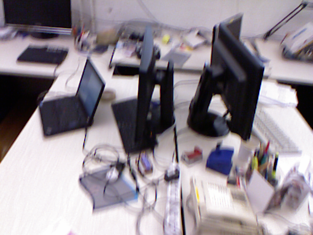
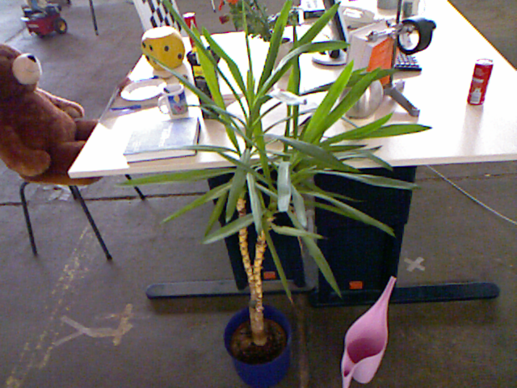
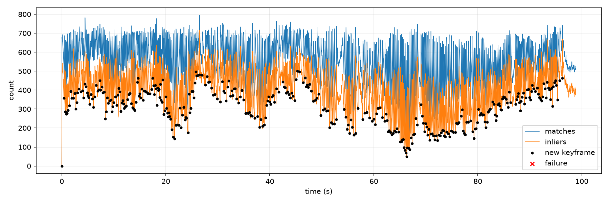
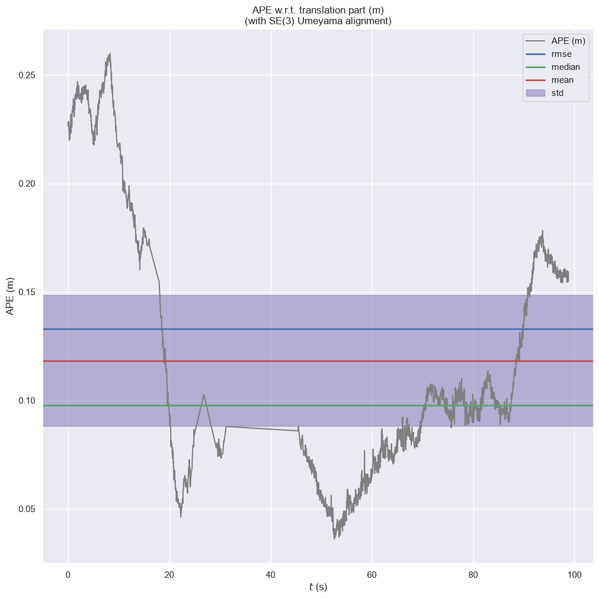

# Failure analysis (v0.1–v0.3)

Sections 1–5 cover the visual odometry of v0.1, section 6 the backend of v0.2, and sections 7–9 loop closure and dynamic scenes (v0.3).

Frame-to-keyframe RGB-D visual odometry: ORB features, PnP + RANSAC on depth-backprojected points, and a new keyframe after 0.05 m, 5° or fewer than 100 inliers. No backend optimization yet. Evaluated with [evo](https://github.com/MichaelGrupp/evo) (`--align`; RPE over 1-second windows, all pairs).

## Summary

| Sequence | Motion | Frames | Keyframes | ATE | RPE (1 s) | Min inliers | Failures |
| --- | --- | --- | --- | --- | --- | --- | --- |
| fr1/xyz | slow, back and forth | 796 | 138 | 5.00 cm | 2.34 cm/s | — | 0 |
| fr2/desk | ~0.19 m/s, 18.9 m loop | 2,965 | 373 | 13.3 cm | 1.62 cm/s | 50 | 0 |
| fr1/desk | ~0.4 m/s, fast handheld | 596 | 172 | 6.49 cm | 3.97 cm/s | 29 | 0 |

Tracking never failed outright. The weaknesses below are where the margin got thin, and where error comes from.

The fr3 sequences of v0.3 (mean ± std over 5 runs, see section 9):

| Sequence | Scene | Frames | Failures | Odometry ATE | Best ATE |
| --- | --- | --- | --- | --- | --- |
| fr3/structure_texture_far | static, repeating texture | 907 | 0 | 8.54 ± 0.51 cm | 4.55 ± 0.39 cm (local BA) |
| fr3/sitting_xyz | two people sitting | 1,219 | 55 | 19.29 ± 0.03 cm | 4.21 ± 0.01 cm (loop closure) |
| fr3/walking_xyz | two people walking | 827 | 107 | 18.37 ± 0.02 cm | 12.15 ± 0.03 cm (loop closure) |

## 1. Ground-truth gaps silently dropped frames (fixed)

The first fr2/desk run gave an ATE of 112 cm, with single-frame jumps of up to 94 cm. The timestamps of the jumps showed the cause: consecutive "frames" were up to 2 seconds apart. The motion-capture ground truth has gaps (one of 12 s), and the dataset loader skipped every frame without a close ground-truth pose, so 705 of 2,965 frames never reached the tracker, which then had to jump across each gap in one step.

**Fix:** ground truth is now optional (`std::optional<Pose>`); a frame needs only RGB and depth to be tracked. Two unit tests guard the behavior.

| fr2/desk | Before | After |
| --- | --- | --- |
| Frames tracked | 2,260 | 2,965 |
| Largest step between frames | 94.1 cm | 3.0 cm |
| ATE | 112 cm | 13.3 cm |
| RPE | 25.2 cm/s | 1.62 cm/s |

**Lesson:** evaluation data must never decide what the system sees. The unit tests passed and no frame "failed"; only measuring against ground truth exposed the bug.

## 2. Motion blur

On fr1/desk, the camera moves about twice as fast as on fr2/desk. Around t ≈ 5–6.5 s the images are visibly blurred, and inliers drop to 29 (from 107 matches). Blur hurts ORB in two ways: fewer sharp corners are detected, and the descriptors of the remaining ones are smeared, so more matches are wrong. The keyframe rate shows the strain: a new keyframe every 3.5 frames on fr1/desk, against about 8 on fr2/desk.

## 3. Close, thin, repetitive foreground objects

The weakest moment on fr2/desk (t ≈ 66 s) is a plant close to the camera, partly combined with blur. The inlier ratio falls from about 70% (485 of 679) to 36% (50 of 140). Three reasons:

- the plant hides the textured objects on the desk behind it;
- the leaves look alike, so features match the wrong leaf;
- depth is unreliable at the edges of thin objects (pixels mix the leaf and the background), which gives wrong 3D points.

## 4. Few inliers does not mean large error

At t ≈ 66 s the ATE curve shows no jump: the error keeps rising slowly, from about 4 cm at t ≈ 52 s to about 10 cm at t ≈ 70 s. The remaining 50 inliers were correct. Few inliers means less margin for the next hard frame, not necessarily a wrong pose.

## 5. Accumulated drift is the main error source

On fr2/desk, the ATE over time is U-shaped: 22–26 cm at the start, about 4 cm in the middle, 16–18 cm at the end. That's the signature of slow drift. The alignment fits the middle of the trajectory best, and the two ends, which drifted in opposite directions, end up furthest from the truth. On the map, the camera's loop around the desk doesn't close. Keyframes already reduce drift (ATE 45.8 → 13.3 cm against frame-to-frame tracking), but odometry alone can't remove error it has already accumulated.

## 6. Bundle adjustment and loop closure interact

BA alone improves ATE on all four sequences, and loop closure alone improves it strongly. Combined, the result is better than loop closure alone on fr1/desk and fr1/room, but worse on fr2/desk (4.6 → 6.1 cm).

An experiment explains part of it: without re-measuring the chain edges from the BA-refined poses, the pose graph converges to exactly the loop-closure-only result (identical to 4 decimals). Its solution depends only on the edges, so BA's work is discarded. With re-measured edges, BA counts, but every edge is still weighted equally, although BA-refined chain edges and PnP loop edges differ in accuracy. Weighting edges by their uncertainty, and a global BA after loop closure with merged map points (as in ORB-SLAM), are the next steps.

## 7. False loops from repeating texture (fixed)

On the static control scene fr3/structure_texture_far, loop closure made ATE worse instead of better: 41.7 cm with loops against 8.7 cm with odometry alone. All 7 accepted loops connected cameras about 1.5 m apart, and they had passed PnP verification with 51–87 inliers.

**Check:** every accepted loop edge is logged (`output/loops.csv`) and compared with the ground truth's relative pose between the two keyframes (`scripts/check_loops.py`). fr2/desk serves as the reference for correct loops.

| | Loops | Translation error | Rotation error |
| --- | --- | --- | --- |
| fr2/desk | 25 | median 1.2 cm, max 2.2 cm | median 0.40°, max 1.21° |
| structure_far, 6 loops | 6 | 6–27 cm | 1.2–6.0° |
| structure_far, loop 74 → 106 | 1 | **2.34 m** | **45.8°** |

Six loops are real revisits seen from about 1.5 m apart, correct but imprecise. One, 74 → 106 with 51 inliers, is false.

**Why PnP accepted it:** the scene repeats the same texture. With a repeating pattern, the matches are consistently wrong: every descriptor matches the same element of the neighboring repetition, so one wrong motion explains them all, with many inliers. On fr1/room, false candidates had 0–7 inliers because their matches were random; here they're systematic, and an inlier threshold can't tell them apart.

**Fix: a consistency check against odometry.** Odometry drifts, but slowly, so a real loop can't disagree with it by more than the drift since the old keyframe. The disagreement is `predicted⁻¹ · measured`, with `predicted` the relative pose from the pose graph. A loop is accepted only if it's within 0.2 m + 10% of the path in between, and 10° + 3° per meter. The 74 → 106 loop disagrees by 2.37 m and 46.6° after about 2 m of path (limits: ≈0.4 m and ≈16°).

The first version used a fixed 20° rotation limit. It rejected 29 real loops on fr1/room, where odometry had drifted about 22° over 12 m of path; their ground-truth errors were at most 3.7 cm and 2.5°. Rotation drift grows with the path like translation drift does, so the rotation limit now grows too.

| Sequence | Loops before → after | Rejected by the check | ATE before → after |
| --- | --- | --- | --- |
| structure_far | 7 → 6 | 1 (74 → 106) | **41.7 → 5.8 cm** |
| fr1/xyz, fr1/desk, fr2/desk, fr1/room | 53, 28, 25, 47 (unchanged) | 0 | unchanged (1.3, 4.1, 4.6, 9.8 cm) |

The decision is a separate function, `loopConsistentWithOdometry()`, with unit tests for the 74 → 106 case, the fr2/desk case (30 cm after 18 m: accepted) and each limit on its own.

**Lesson:** geometric verification checks that the matches agree with each other, not that they're right. A second, independent source of information (here odometry) catches what the first one can't.

## 8. Edge weighting

Three results point to the same cause:

- **structure_far:** the 6 remaining loops are correct but imprecise (6–27 cm). Loop closure alone still helps against odometry (8.54 ± 0.51 → 5.81 ± 0.18 cm), but on top of local BA it costs accuracy: 4.55 ± 0.39 → 5.29 ± 0.06 cm, and RPE doubles (2.07 → 4.14 cm).
- **fr2/desk:** BA + loop closure is worse than loop closure alone (4.6 → 6.1 cm, section 6).
- **sitting_xyz:** masking doubles the number of loops (39 → 84, all correct against the ground truth), yet ATE gets worse (4.21 ± 0.01 → 4.87 ± 0.02 cm) and so does RPE (3.78 → 4.54 cm).

**Likely cause:** every edge in the pose graph has the same weight. A loop edge measured by PnP between keyframes 1.5 m apart, accurate to 10–25 cm, counts as much as a BA-refined chain edge accurate to about 1 cm. More loops then means more imprecise constraints pulling on the trajectory, and better chain edges (BA) lose against them.

**Next step:** weight each edge by its uncertainty, for example from the PnP covariance or the inlier count and baseline of a loop, so imprecise loops pull less. This is still a hypothesis; the experiment is to compare the three cases above with weighted edges.

## 9. Dynamic scenes and noise

### People are the problem, not the camera

A control experiment with the same fr3 camera, configuration and code on a static scene:

| fr3 sequence | Median inlier ratio | Failures | Odometry ATE / RPE |
| --- | --- | --- | --- |
| structure_texture_far (static) | 0.81 | 0 | 8.7 cm / 2.8 cm |
| sitting_xyz (people sitting) | 0.31 | 55 | 19.3 cm / 5.1 cm |
| walking_xyz (people walking) | ~0.2–0.3 | 107 | 18.3 cm / 12.2 cm |

With people in view, the inlier ratio falls from 0.81 to 0.31: their keypoints move with them, and PnP can't explain them with the camera's motion.

### What masking can and can't fix

Masking removes keypoints on people (18.6% of the image on walking, 23.4% on sitting, on average). Where people are in view, it helps a lot: on walking frame 60, inliers go from 116 to 231. It also doubles the number of correct loops on both sequences, likely because keyframes are then described by the static background only.

It can't fix the failures. They come in one burst per sequence (walking: 6–14 s; sitting: 16–20 s), while the camera faces the high ceiling: too far for the depth sensor, so valid depth drops to 0.40–0.49 of the image (0.54–0.73 elsewhere), few keypoints get a 3D point, and frames fail with 9–15 inliers. With the mask, 106 of walking's 107 failed frames are the same frames. Each failure loses that frame's motion, which likely dominates ATE more than masking can improve it.

### The noise level

Changing one keypoint can change which frames become keyframes, which changes everything after it. So a single run's ATE can't show small differences. Each configuration is run 5 times, starting at frames 0–4 (`--start`): almost the same data, but the keyframes fall differently. Results are mean ± std (`scripts/noise_runs.py`).

- Most spreads are small: 0.01–0.2 cm on the dynamic sequences, 0.2–0.5 cm on structure_far. A shift of 1–4 frames is a weak perturbation, so these spreads are a lower bound on the noise, not an upper one.
- One configuration is bimodal: walking with loop closure and mask lands on either about 10.1 cm (starts 1 and 3) or about 15.5 cm (starts 0, 2 and 4). A single run of it could show masking as a 2 cm gain or a 3 cm loss.

### A false detection on the static scene is a real effect, not noise

Masking should change nothing on the static scene, yet odometry ATE improves from 8.54 ± 0.51 to 5.41 ± 0.23 cm: the ranges don't overlap. The model marks 0.06% of the pixels on average, but that hides where: on 71 frames (about 327–440), it marks up to 2.4% of the image, a blurred, beige, folded patch at the poster's top-right corner, where the poster meets the far wall. There's no person in the scene.

The effect is local. Mean translation error over 30-frame windows:

| Frames | 0–300 | 300–330 | 330–450 | 450–600 | 600–877 |
| --- | --- | --- | --- | --- | --- |
| no mask | 1.57 cm | 2.29 cm | **4.14 cm** | 2.00 cm | 1.80 cm |
| mask | 1.57 cm | 2.29 cm | **3.66 cm** | 1.75 cm | 1.80 cm |

The two runs are identical until the mask switches on, and the difference lies where the mask is active and just after it, in the worst-tracked stretch of the sequence. So part of masking's gain may come from removing bad regions rather than people.

**Hypothesis (not tested):** keypoints on that patch are unreliable because it's blurred and lies on a depth edge, where pixels mix the poster and the wall (as with the plant in section 3). **Experiment:** mask the same patch by hand, and patches of the same size elsewhere, to separate "removing bad keypoints" from chance.

## Next steps

| Problem | Fix | Status |
| --- | --- | --- |
| A wrong estimate could be accepted | reject estimates with too few inliers or an impossible motion between frames | Done (v0.2) |
| Accumulated drift; the loop doesn't close | local bundle adjustment, pose graph and loop closure | Done (v0.2) |
| False loops from repeating texture pass PnP verification (section 7) | consistency check against odometry | Done (v0.3) |
| Moving objects (section 9) | segmentation masks for people (Step 5) | Done (v0.3): more correct loops, lower RPE on walking; ATE not reliably better |
| Single runs can mislead (section 9) | report mean ± std over 5 runs | Done (v0.3) |
| BA and loop closure interact; imprecise loops hurt (sections 6 and 8) | weight edges by their uncertainty; global BA after loop closure with merged map points | Planned |
| Failures while facing the ceiling: too little valid depth (section 9) | keep the motion through failed frames instead of losing it | Planned |
| Bad regions at depth edges (section 9) | test the hypothesis: mask the patch by hand vs. random patches | Planned |