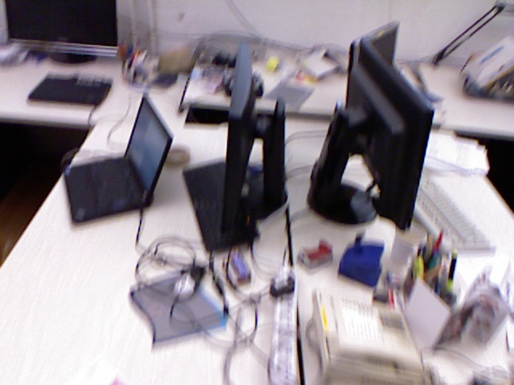
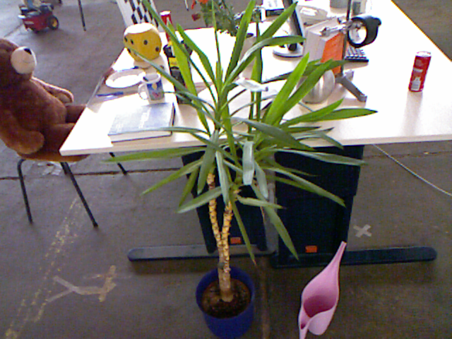
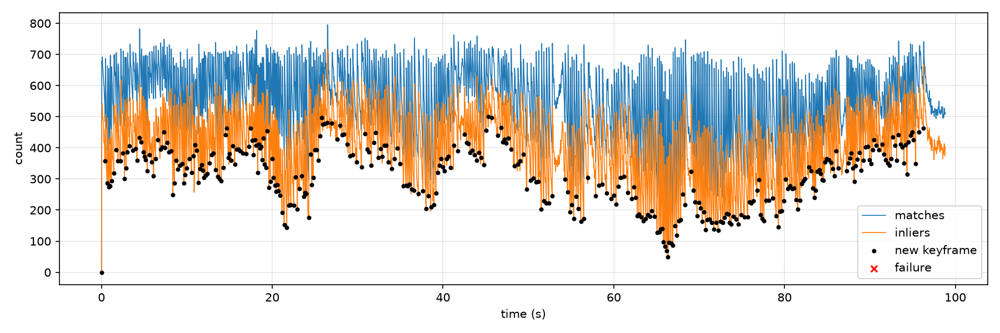
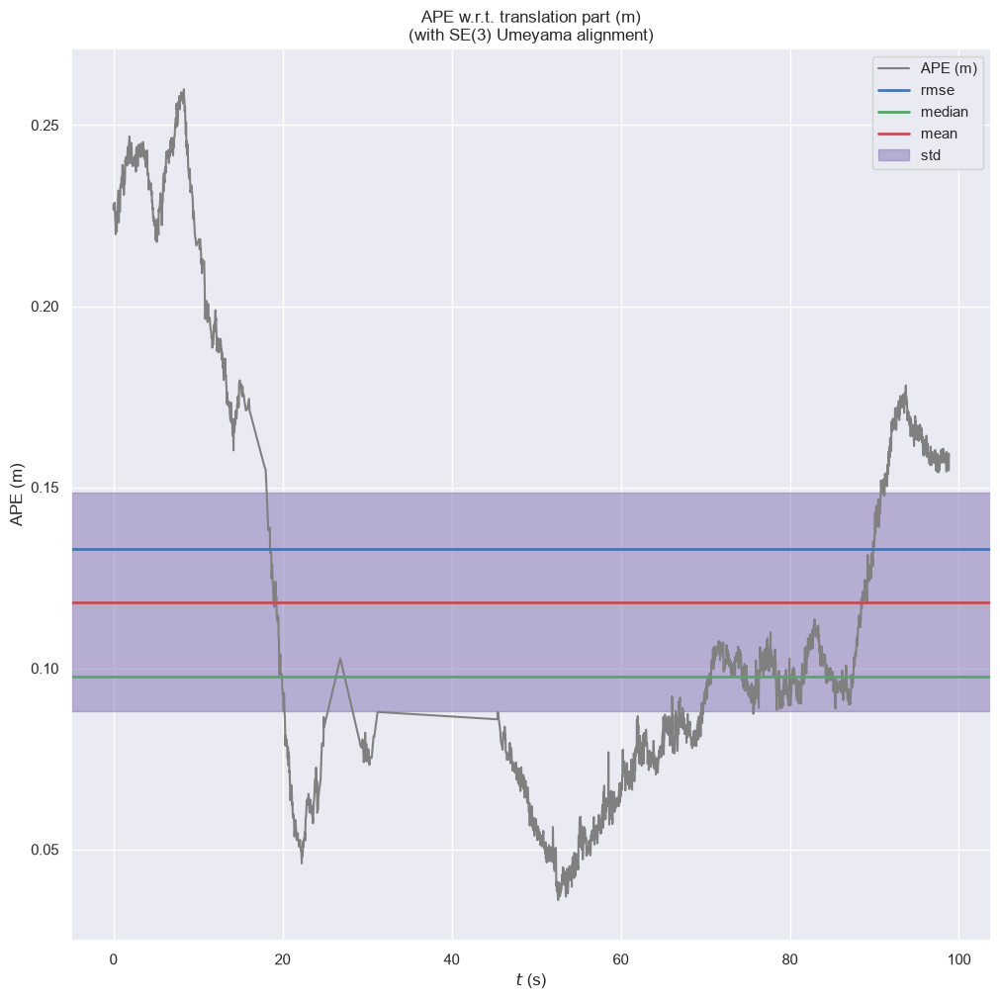

# Failure analysis: visual odometry (v0.1)

Frame-to-keyframe RGB-D visual odometry: ORB features, PnP + RANSAC on depth-backprojected points, and a new keyframe after 0.05 m, 5° or fewer than 100 inliers. No backend optimization yet. Evaluated with [evo](https://github.com/MichaelGrupp/evo) (`--align`; RPE over 1-second windows, all pairs).

## Summary

| Sequence | Motion | Frames | Keyframes | ATE | RPE (1 s) | Min inliers | Failures |
| --- | --- | --- | --- | --- | --- | --- | --- |
| fr1/xyz | slow, back and forth | 796 | 138 | 5.00 cm | 2.34 cm/s | — | 0 |
| fr2/desk | ~0.19 m/s, 18.9 m loop | 2,965 | 373 | 13.3 cm | 1.62 cm/s | 50 | 0 |
| fr1/desk | ~0.4 m/s, fast handheld | 596 | 172 | 6.49 cm | 3.97 cm/s | 29 | 0 |

Tracking never failed outright. The weaknesses below are where the margin got thin, and where error comes from.

## 1. Ground-truth gaps silently dropped frames (fixed)

The first fr2/desk run gave an ATE of 112 cm, with single-frame jumps of up to 94 cm. The timestamps of the jumps showed the cause: consecutive "frames" were up to 2 seconds apart. The motion-capture ground truth has gaps (one of 12 s), and the dataset loader skipped every frame without a close ground-truth pose, so 705 of 2,965 frames never reached the tracker, which then had to jump across each gap in one step.

**Fix:** ground truth is now optional (`std::optional<Pose>`); a frame needs only RGB and depth to be tracked. Two unit tests guard the behavior.

| fr2/desk | Before | After |
| --- | --- | --- |
| Frames tracked | 2,260 | 2,965 |
| Largest step between frames | 94.1 cm | 3.0 cm |
| ATE | 112 cm | 13.3 cm |
| RPE | 25.2 cm/s | 1.62 cm/s |

**Lesson:** evaluation data must never decide what the system sees. The unit tests passed and no frame "failed"; only measuring against ground truth exposed the bug.

## 2. Motion blur

On fr1/desk, the camera moves about twice as fast as on fr2/desk. Around t ≈ 5–6.5 s the images are visibly blurred, and inliers drop to 29 (from 107 matches). Blur hurts ORB in two ways: fewer sharp corners are detected, and the descriptors of the remaining ones are smeared, so more matches are wrong. The keyframe rate shows the strain: a new keyframe every 3.5 frames on fr1/desk, against about 8 on fr2/desk.

## 3. Close, thin, repetitive foreground objects

The weakest moment on fr2/desk (t ≈ 66 s) is a plant close to the camera, partly combined with blur. The inlier ratio falls from about 70% (485 of 679) to 36% (50 of 140). Three reasons:

- the plant hides the textured objects on the desk behind it;
- the leaves look alike, so features match the wrong leaf;
- depth is unreliable at the edges of thin objects (pixels mix the leaf and the background), which gives wrong 3D points.

## 4. Few inliers does not mean large error

At t ≈ 66 s the ATE curve shows no jump: the error keeps rising slowly, from about 4 cm at t ≈ 52 s to about 10 cm at t ≈ 70 s. The remaining 50 inliers were correct. Few inliers means less margin for the next hard frame, not necessarily a wrong pose.

## 5. Accumulated drift is the main error source

On fr2/desk, the ATE over time is U-shaped: 22–26 cm at the start, about 4 cm in the middle, 16–18 cm at the end. That's the signature of slow drift. The alignment fits the middle of the trajectory best, and the two ends, which drifted in opposite directions, end up furthest from the truth. On the map, the camera's loop around the desk doesn't close. Keyframes already reduce drift (ATE 45.8 → 13.3 cm against frame-to-frame tracking), but odometry alone can't remove error it has already accumulated.

## 6. Bundle adjustment and loop closure interact

BA alone improves ATE on all four sequences, and loop closure alone improves it strongly. Combined, the result is better than loop closure alone on fr1/desk and fr1/room, but worse on fr2/desk (4.6 → 6.1 cm).

An experiment explains part of it: without re-measuring the chain edges from the BA-refined poses, the pose graph converges to exactly the loop-closure-only result (identical to 4 decimals). Its solution depends only on the edges, so BA's work is discarded. With re-measured edges, BA counts, but every edge is still weighted equally, although BA-refined chain edges and PnP loop edges differ in accuracy. Weighting edges by their uncertainty, and a global BA after loop closure with merged map points (as in ORB-SLAM), are the next steps.

## Next steps

| Problem | Fix | Status |
| --- | --- | --- |
| A wrong estimate could be accepted | reject estimates with too few inliers or an impossible motion between frames | Done (v0.2) |
| Accumulated drift; the loop doesn't close | local bundle adjustment, pose graph and loop closure | Done (v0.2) |
| BA and loop closure interact (section 6) | weight edges by their uncertainty; global BA after loop closure with merged map points | Planned |
| Moving objects (not yet tested) | segmentation masks for people (Step 5) | Planned |